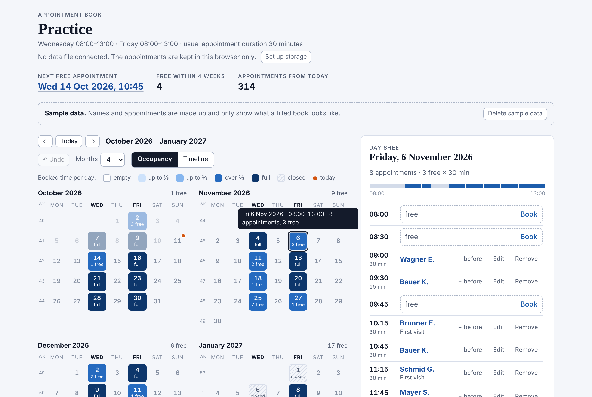
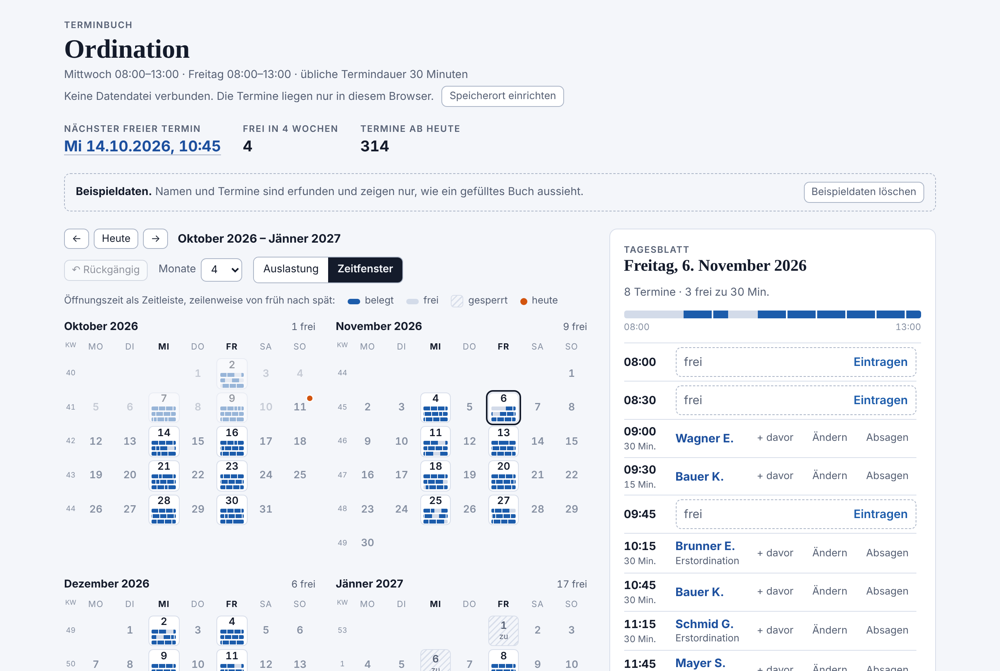

# Ordinations-Terminbuch · Appointment Book

A digital appointment book for a small practice, in one HTML file. It replaces the paper calendar at the front desk: appointments of any length, free and booked times at a glance, no installation, no server, no internet. The interface is available in German and English.

It was made for a doctor's practice that is open two days a week and booked months ahead. Opening days, hours and the usual appointment duration can be changed freely, so it fits any small business that hands out appointments.

## Features

- **Month overview** for 1 to 12 months, either as occupancy in colour steps or as a timeline per day
- **Day sheet** with all appointments and free times of the selected day
- **Book, edit, move, insert and remove** appointments, also by dragging with the mouse; following appointments move back only as far as needed
- **Find the next free appointment** from any date, and search appointments by name, phone or note
- **Undo** for up to 30 changes
- **Name list** with suggestions for name, phone and note
- **Day sheets as files**: PDF, Word, Excel, OpenDocument Text and Spreadsheet, plain text, Markdown
- **Data file** that receives every change automatically, plus backup at the push of a button
- **Austrian public holidays** closed automatically, single days can be closed or opened as extra days
- **Light and dark** display, following the operating system

## Quick start

1. Download `Terminbuch.html`.
2. Double-click it. It opens in the browser and shows made-up sample data.
3. Click **Delete sample data**.
4. Open **Opening hours, appointment duration and backup** at the bottom of the left column. Set the opening days, the hours and the usual appointment duration.
5. Click **Choose storage folder** and pick the folder that contains `Terminbuch.html`. From then on every change is also written to `terminbuch-daten.json` in that folder.

| Requirement | Details |
| --- | --- |
| Browser | A current Chrome or Edge is recommended. Firefox runs everything except the storage folder, the data file and the name file. |
| Internet | Not needed. The file loads nothing from the net. |
| Device | Made for a PC with a mouse. On tablets and phones the page switches to one column, and dragging is not available. |

## Language

The interface starts in German when the browser is set to German, otherwise in English. You can switch at any time under **Sprache / Language** in the settings; the choice is saved.

The language also applies to dates, holiday names and the saved day sheets. What you enter yourself stays as it is, and the data file keeps its name `terminbuch-daten.json` in both languages.

## Where the data is kept

| Place | When | Notes |
| --- | --- | --- |
| Browser storage | always | Tied to this one browser. Deleting the site data deletes the appointment book. |
| Data file `terminbuch-daten.json` | after choosing a storage folder, in Chrome and Edge | Recommended. An ordinary JSON file on the PC or a network share, included in any normal backup. |
| Backup `terminbuch-YYYY-MM-DD_HHMM.json` | on **Create backup** | A dated copy of everything, can be restored on any PC. |

Nothing is sent anywhere. All data stays on your own computer.

After a restart the browser asks once for permission to access the data file again. Until you allow it, changes are saved in the browser only.

## Limits

| Item | Value |
| --- | --- |
| Appointments in total | about 60,000 in the browser, measured with name, phone and note |
| Appointments per day | up to 288 (5-minute appointments around the clock) |
| Duration of an appointment | 5 to 600 minutes in 5-minute steps |
| Opening hours | one continuous time window per weekday |
| Name, phone, note | 80, 40 and 120 characters |
| Undo | 30 steps |

## What it does not do

- **No multi-user operation.** Two PCs cannot work in the same book at the same time. With the data file on a share they can work one after the other; simultaneous changes are detected and reported, not merged.
- **No password, no encryption.** Whoever can use the PC and the browser can see the appointments. Backup files are not encrypted either.
- **No online booking and no reminders.** Patients cannot book themselves, and the program sends neither text messages nor e-mail.
- **No recurring appointments, no patient records, no billing.** Only name, phone and a short note are stored.
- **Holidays are Austrian.** The automatic rule knows the 13 Austrian public holidays; other days can be closed by hand.

## Privacy

Names, phone numbers and appointments of patients are personal data. Use a password-protected user account on the PC, and keep backups and saved day sheets in a protected place. Whether the program meets the legal requirements of your practice is for you to assess.

## Files in this repository

| File | Purpose |
| --- | --- |
| `Terminbuch.html` | the whole program |
| `Terminbuch.ico` | the icon, for a desktop shortcut |
| `docs/Programmbeschreibung.md` | the complete manual, in German |
| `screenshots/` | the pictures used on this page |
| `LICENSE` | the licence text |

## State of testing

All functions were played through in a Chromium test browser, in German and in English. The seven file formats were opened and checked with LibreOffice and other tools; they were not tested with Microsoft Word and Excel. Run the program next to your paper calendar for a few days before you rely on it.

## License

MIT, see [LICENSE](LICENSE).

---

## Deutsch

Das Ordinations-Terminbuch ersetzt den Papierkalender am Empfang durch eine einzelne HTML-Datei, die im Browser läuft. Es verwaltet Termine mit frei wählbarer Dauer, zeigt freie und belegte Zeiten auf einen Blick und braucht weder Installation noch Internet. Die Oberfläche gibt es auf Deutsch und Englisch.

### Schnellstart

1. `Terminbuch.html` herunterladen und doppelklicken.
2. **Beispieldaten löschen** anklicken.
3. Unter **Öffnungszeiten, Termindauer und Sicherung** die Ordinationstage, die Zeiten und die übliche Termindauer einstellen.
4. **Speicherordner wählen** anklicken und den Ordner der `Terminbuch.html` auswählen. Ab dann schreibt das Programm jede Änderung auch in die Datei `terminbuch-daten.json`.

Empfohlen sind Chrome oder Edge. In Firefox läuft alles außer Speicherordner, Datendatei und Namensdatei.

### Gut zu wissen

- Alle Daten bleiben auf dem eigenen PC, das Programm überträgt nichts.
- Es ist ein Einzelplatzprogramm ohne Kennwort und ohne Verschlüsselung.
- Die Sprache lässt sich in den Einstellungen bei **Sprache / Language** umstellen.
- Die vollständige Beschreibung steht in [docs/Programmbeschreibung.md](docs/Programmbeschreibung.md).
